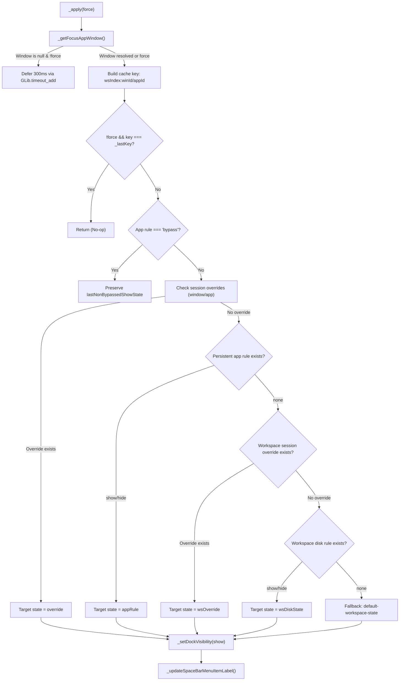

# Repository Map & Architecture Baseline

## 1. Overview and Target Version Range

- **Repository Path**: `~/Documents/GITHUB PROJECTS/adaptive-dock`
- **Target GNOME Shell Versions** (from `metadata.json` line 6):
  ```json
  "shell-version": ["46", "47", "48", "49", "50"]
  ```
- **Declared Version Gates in Source Code**:
  - `extension.js:60`: Duck-typing check `typeof Main.osdWindowManager._showOsdWindow === 'function'` for hooking system OSD windows.
  - `extension.js:392`: Clutter Actor name resolution `actor.name || (actor.get_name ? actor.get_name() : '')` supporting GNOME 45+ ESM property changes.
  - `extension.js:497-503`: Fallback cascade for OSD invocation (`Main.osdWindowManager.showAll` vs `Main.osdWindowManager.show`).

---

## 2. Extension Call Graph & Execution Flows

### 2.1 Lifecycle Initialization (`enable()`)
Located at `extension.js:14-97`:
1. `_getDockSettings()`: Locates `org.gnome.shell.extensions.dash-to-dock` or `org.gnome.shell.extensions.ubuntu-dock` schemas from default sources or user/system extension directories.
2. `_loadAppStates()`: Reads JSON from `~/.config/dock-app-states.json` into memory (`this._appStates`).
3. Instantiates in-memory session maps:
   - `this._sessionAppStates = new Map()`
   - `this._sessionWindowStates = new Map()`
   - `this._sessionWorkspaceStates = new Map()`
   - `this._windowSignals = new Map()`
4. File Monitor: Connects `Gio.File.monitor_file` to `APP_STATES` (`dock-app-states.json`) to reload state and invoke `this._apply(true)` when preferences change.
5. Keybindings (`Main.wm.addKeybinding`):
   - `'toggle-dock'` -> `this._toggleApp()`
   - `'toggle-workspace-dock'` -> `this._toggleWorkspace()`
6. System OSD Monkey-Patch: Intercepts `Main.osdWindowManager._showOsdWindow` to reset `translation_y = 0` for non-dock notifications (volume, brightness).
7. System Signals Connected:
   - `this._kb.connect('changed::edge-hover-reveal', () => this._apply(true))`
   - `this._kb.connect('changed::default-workspace-state', () => this._apply(true))`
   - `this._kb.connect('changed::request-add-workspace', () => ...)`
   - `this._kb.connect('changed::integrate-space-bar', () => this._updateSpaceBarIntegration())`
   - `global.display.connect('notify::focus-window', () => this._apply())`
   - `global.workspace_manager.connect('active-workspace-changed', () => { this._apply(); this._syncWorkspaces(); })`
   - `global.workspace_manager.connect('notify::n-workspaces', () => this._syncWorkspaces())`
   - `global.workspace_manager.connect('workspaces-reordered', () => this._syncWorkspaces())`
   - `this._tracker.connect('tracked-windows-changed', () => this._syncWorkspaces())`
   - `this._wm.connect('changed::workspace-names', () => this._syncWorkspaces())`
8. Initial execution: Runs `this._syncWorkspaces()`, `this._updateSpaceBarIntegration()`, and `this._apply(true)`.

### 2.2 Lifecycle Teardown (`disable()`)
Located at `extension.js:99-163`:
1. Cleans Space Bar integration: disconnects menu items and listeners.
2. Restores `Main.osdWindowManager._showOsdWindow` to `this._origShowOsdWindow`.
3. Unbinds keybindings via `Main.wm.removeKeybinding`.
4. Disconnects all GSettings listeners (`this._edgeRevealId`, `this._defaultWsStateId`, `this._spaceBarSettingId`, `this._addWsId`).
5. Disconnects display signals (`notify::focus-window`).
6. Disconnects workspace manager signals (`active-workspace-changed`, `notify::n-workspaces`, `workspaces-reordered`).
7. Disconnects tracker and WM settings signals (`tracked-windows-changed`, `changed::workspace-names`).
8. Cancels and disconnects file monitor (`this._monitor`).
9. Unregisters window unmanaged handlers in `this._windowSignals`.
10. Cancels deferred timeouts (`this._deferTimeoutId`).
11. Restores `translation_y = 0` on all `Main.osdWindowManager._osdWindows`.
12. Clears in-memory maps and nulls out references to allow garbage collection.

### 2.3 Evaluation Pipeline (`_apply()`)
Located at `extension.js:697-801`:


---

## 3. Global-Assumption Audit (Refactor Checklist)

Below is the exhaustive inventory of monitor-agnostic assumptions baked into the codebase:

| Location | Site / Mechanism | Global Assumption | Required Refactoring |
|---|---|---|---|
| `extension.js:26-28` | State maps (`_sessionAppStates`, `_sessionWindowStates`, `_sessionWorkspaceStates`) | Stored globally in single flat `Map` instances without monitor segregation. | Namespace session storage by monitor connector when isolation is enabled. |
| `extension.js:32, 734, 788, 799` | `this._lastNonBypassedShowState` | Single boolean scalar representing dock state across all screens. | Maintain a per-connector map of last known non-bypassed visibility states. |
| `extension.js:83` | `global.display.connect('notify::focus-window')` | Triggers global `_apply()`; assumes one dock policy fits all screens. | Resolve target monitor of focus window, evaluate state for that monitor domain. |
| `extension.js:84` | `global.workspace_manager.connect('active-workspace-changed')` | Triggers global `_apply()`; assumes workspace switch changes state globally. | Evaluate workspace switch within the active monitor domain. |
| `extension.js:208-223` | `_writeAppState(appId, state)` | Overwrites `~/.config/dock-app-states.json` without monitor keying. | Write to monitor-keyed storage schema when isolation is active. |
| `extension.js:243-259` | `_writeWorkspaceState(wsIndex, state)` | Overwrites root files in `~/.config/dock-workspace-states/`. | Store in per-monitor connector subdirectories. |
| `extension.js:270-280` | `_setDockVisibility(show)` | Directly toggles global GSettings key `intellihide` on Dash to Dock. | Keep monitor bookkeeping segregated; drive Dash to Dock visibility appropriately. |
| `extension.js:365` | `_getDockGeometry(monitorIndex = -1)` | Defaults to `-1` (all monitors), picking the first detected dock height. | Pass resolved monitor index to compute exact dock geometry per display. |
| `extension.js:451-507` | `_showOsd(iconName, label)` | Elevates all OSD windows (`translation_y`) and passes `-1` to `show()`, displaying on every screen. | Target single `monitorIndex` in `show()` and elevate only that monitor's OSD actor. |
| `extension.js:563-627` | `_toggleApp()` | Shortcuts read global `intellihide` and show OSD on all screens. | Resolve focused monitor via `getFocusedMonitor()`, mutate that monitor's session/persistent state, scope OSD to that screen. |
| `extension.js:629-695` | `_toggleWorkspace()` | Shortcut operates on global workspace session map and shows global OSD. | Mutate workspace state for focused monitor domain only; scope OSD to focused monitor. |
| `extension.js:725-727` | Cache key `_lastKey = ${wsIndex}:${winId ?? appId}` | Omits monitor identifier; switching between windows across monitors with same ID skips evaluation. | Include monitor connector in cache key: `${connector}:${wsIndex}:${winId ?? appId}`. |
| `prefs.js:20-56` | `readApps`, `writeApps`, `readWs`, `writeWs` | Read and write flat global files in `~/.config/`. | Update preferences to support per-monitor display selection when isolation is active. |

---

## 4. On-Disk Persistence Layout Baseline

### 4.1 Application State Store (`~/.config/dock-app-states.json`)
Current format is a single JSON document mapping application identifiers to state strings (`"show"`, `"hide"`, `"bypass"`):

**Live Sample from Host Disk**:
```json
{
  "ai.storyteller.pdfcraft": "show",
  "chrome-agimnkijcaahngcdmfeangaknmldooml-Default": "hide",
  "chrome-cinhimbnkkaeohfgghhklpknlkffjgod-Default": "hide",
  "com.google.Chrome": "show",
  "dev.gustavosett.clipboard-history": "bypass",
  "google-chrome": "show",
  "io.github.harshp2008.win11clip": "bypass",
  "software-properties-drivers": "show",
  "win11-clipboard-history": "bypass",
  "win11-clipboard-history-bin": "bypass",
  "win11clip": "bypass",
  "win11clip-bin": "bypass"
}
```

### 4.2 Workspace State Store (`~/.config/dock-workspace-states/`)
Current format stores individual text files named `<workspaceName>.state`. Content contains unquoted plain-text tokens representing visibility (`"true"`, `"false"`, `"show"`, `"hide"`).

**Live Samples from Host Disk**:
- File: `/home/harsh/.config/dock-workspace-states/General.state`
  ```text
  false
  ```
- File: `/home/harsh/.config/dock-workspace-states/College Admission.state`
  ```text
  true
  ```
- File: `/home/harsh/.config/dock-workspace-states/spawn-at.state`
  ```text
  show
  ```
